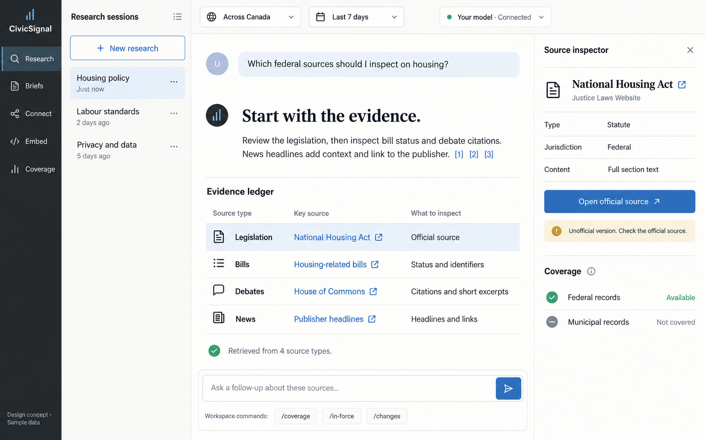
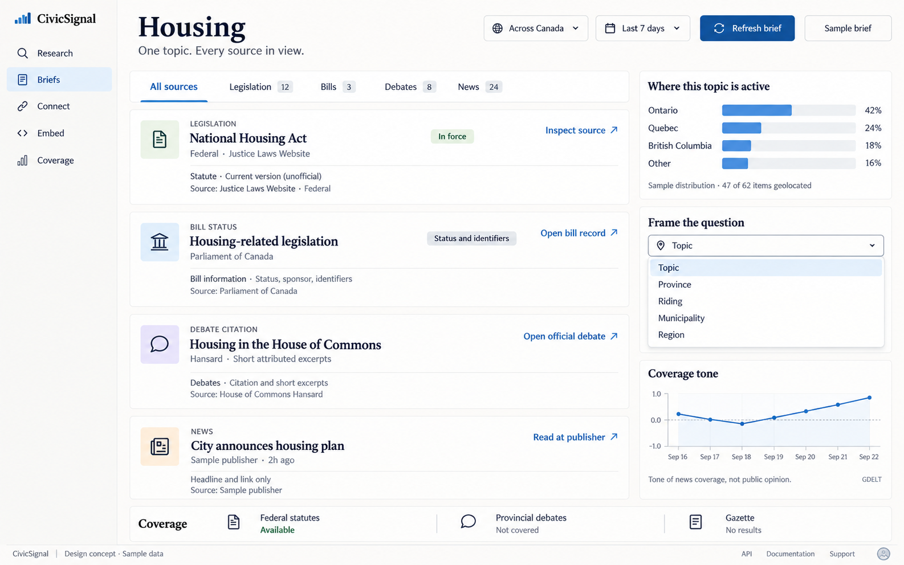

# CivicSignal interface concepts

Image-generated design proposals based on the repository as reviewed on 2026-10-20. Generated with the built-in `image_gen` tool. The initial screen prompt set is saved in [prompts.json](prompts.json).

## Five art directions for the main screen

Latest refinement: [OS 9 × Swiss Editorial](art-directions/06-os9-swiss-editorial.png), using the user's actual CHS OS 9 kit. Its [prompt and reference roles](art-directions/06-os9-swiss-editorial.prompt.json) are saved alongside the image.

[Open the five-direction gallery](art-directions/README.md): Swiss editorial, financial terminal, civic atlas, paper research desk, and minimalist studio. Each uses the baseline research workspace below as its edit target. The exact final prompts are saved in [art-directions/prompts.json](art-directions/prompts.json).

The delivered screen images are the baseline research workspace, the topic brief, and the five art directions. The connection-console and embed-builder descriptions below record additional proposed flows.

These are proposed interfaces. The repository currently implements the corpus/API/MCP and BYOK chat layers; it does not contain a web frontend. All displayed records, counts, dates, usage and distributions are illustrative. No application source files were changed for this design exploration.

## 1. Research workspace

A hosted research session with a reading area, citation markers, retrieval activity and a source inspector. Provider selection and follow-up questions sit close to the conversation. Coverage is visible alongside the evidence.

Grounded in [the harness plan](../../../HARNESS.md), [BYOK chat](../../../../src/routes/chat.ts), and [the model context rules](../../../../src/byok.ts). The hosted session shell, command UI and persistent session list are proposed; they are not shipped by the existing chat route.

## 2. Topic brief and geographic framing

The core join made visible: legislation, bill metadata, debate citations and news headlines in a single evidence list. The geographic distribution helps a user choose how to frame the question, while the coverage-tone chart remains explicitly separate from public opinion.

Grounded in [the brief response](../../../../src/routes/brief.ts), [scope types](../../../../src/corpora/types.ts), [the corpus registry](../../../../src/corpora/registry.ts), and [source policies](../../../../src/corpora/policies.ts). Sample coverage states illustrate the intended distinction between absent coverage and zero matches; the frontend would need to resolve those states from source capabilities and result metadata.

## 3. API and MCP connection console

Additional proposed flow; no generated image is included in this set.

A developer playground with request parameters, a masked key and an inspectable response. A parallel path connects the same corpus to an agent through the three existing MCP tools.

Grounded in [capabilities and published pricing](../../../../src/routes/capabilities.ts), [HTTP routes](../../../../src/index.ts), [the MCP server](../../../../src/mcp/server.ts), and [billing](../../../../src/spine/billing.ts). Usage values are illustrative. The visible JSON is an abbreviated example, not the full brief response schema. Key management and the usage display are proposed UI.

## 4. Embeddable brief configurator

Additional proposed flow; no generated image is included in this set.

A configuration surface for topic, geography, date window and source types, with a compact customer-facing preview. This explores the widget described in wave 4 of the product plan.

Grounded in [the product plan](../../../PLAN.md), [scope parsing](../../../../src/corpora/scope.ts), and [the source policies](../../../../src/corpora/policies.ts). The configurator, browser component and embed markup are proposals. There is no shipped widget or registration contract in this repository. Browser-key restrictions would need to be implemented and verified for this surface.

## Shared design choices

- Reading and inspection take priority over summary metric tiles.
- Source provenance appears beside each result.
- News remains headline, publisher, timestamp and link; article text is not reproduced.
- Debate remains a citation or short attributed excerpt.
- Statute reading carries the unofficial-version notice.
- Geography is a framing lens, not an on/off mode.
- Sample coverage, freshness and usage are labelled rather than presented as production data.

The visual treatment is exploratory; the repository does not establish a frontend design system or final brand identity.

