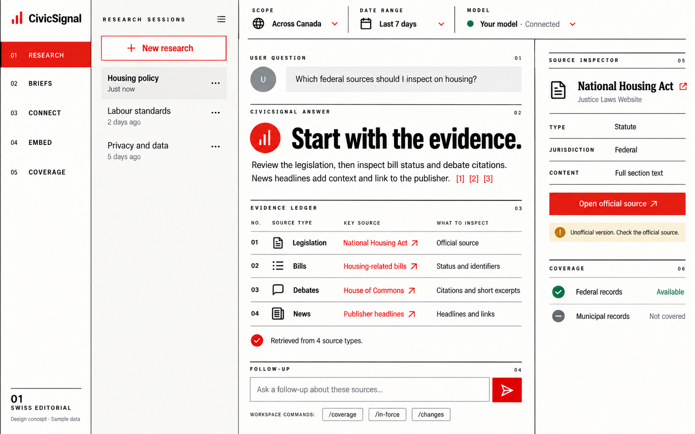
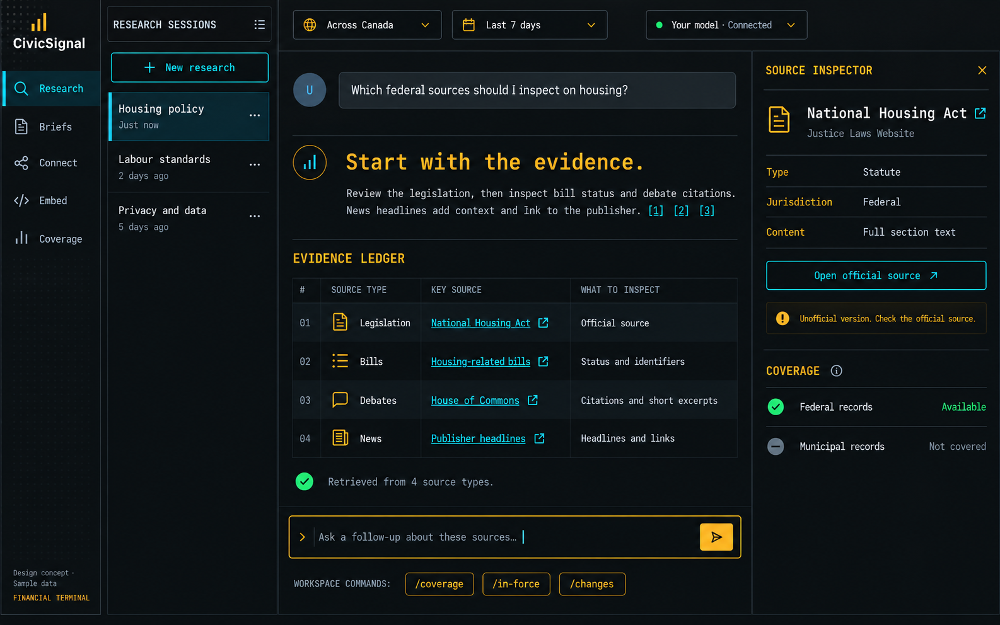
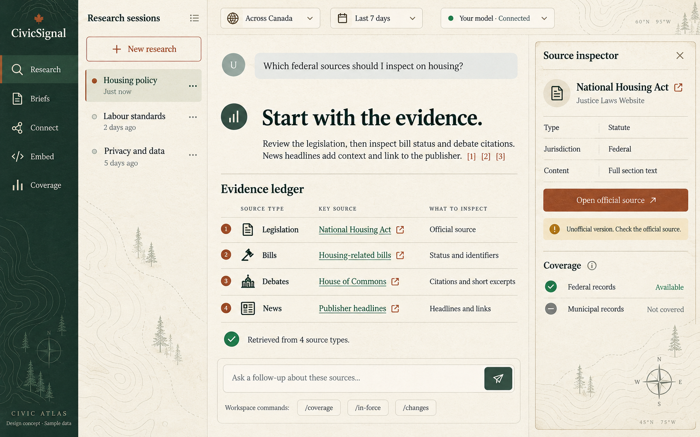
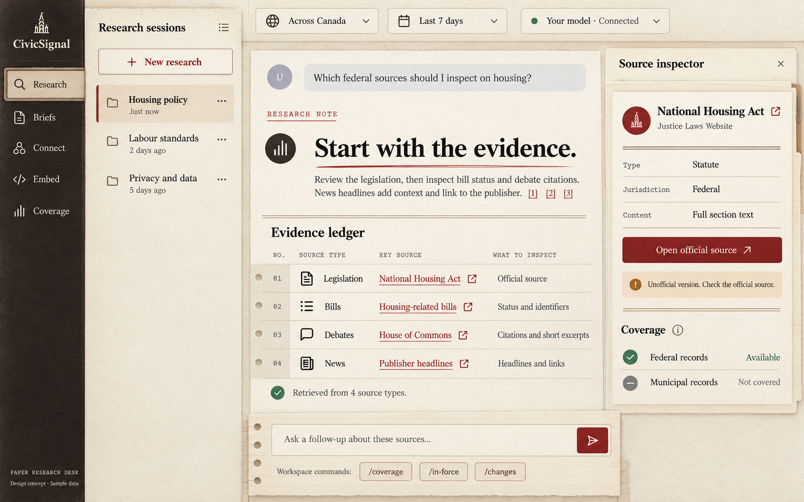
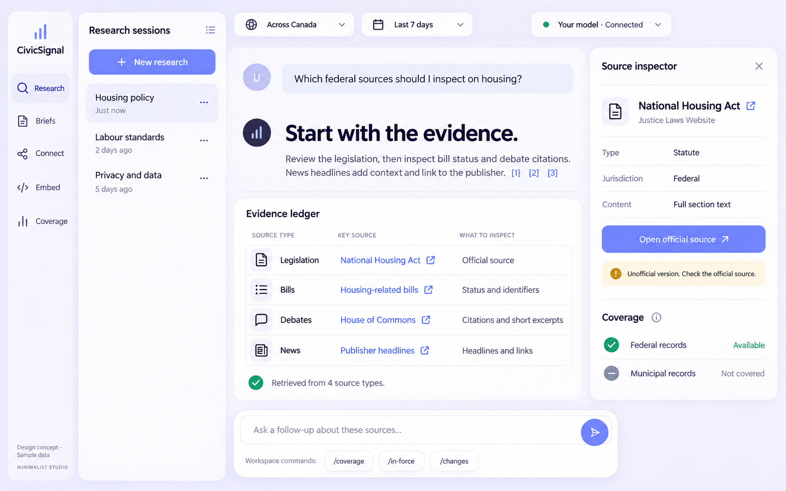
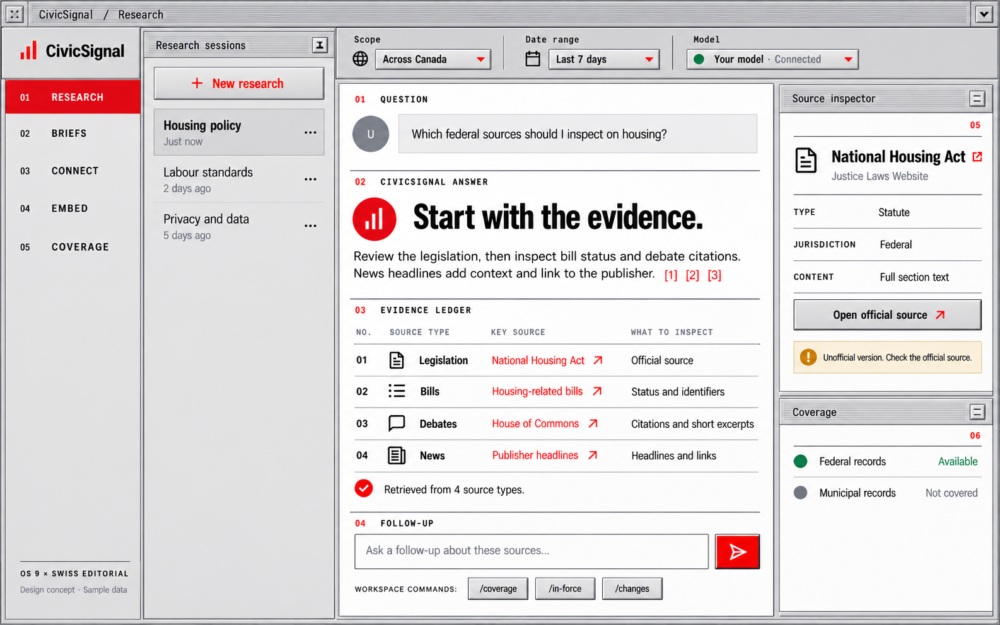

# Five directions for the main research screen

Five image-generated interpretations of the same CivicSignal research workspace. Each keeps the session list, cited answer, evidence list, source inspector and follow-up composer so the visual direction can be compared.

Created using the built-in `image_gen` tool, with [the baseline research screen](../01-research-workspace.png) as the edit target. The exact final prompt for each direction is saved in [prompts.json](prompts.json).

## 1. Swiss editorial

Inspiration: Swiss modernist typography and a serious public-policy journal.

## 2. Financial terminal

Inspiration: A financial market terminal and a newsroom operations console.

## 3. Civic atlas

Inspiration: A contemporary cartographic atlas and a national park field guide.

## 4. Paper research desk

Inspiration: An archival reading room, a legal research notebook and a clipped document dossier.

## 5. Minimalist studio

Inspiration: A contemporary Scandinavian design studio and a calm premium desktop productivity app.

## Refined direction: OS 9 × Swiss Editorial

Uses the actual CHS UI Kit OS 9 preset as a style reference, combined with the Swiss Editorial screen above. Platinum surfaces, restrained bevels and thin pinstriped title bars support a white reading canvas, a disciplined grid and vermilion accents. Chicago-style details stay in small panel labels; the main reading typography stays contemporary.

References: [actual OS 9 kit screenshot](os9-kit-reference.jpg), [Swiss screen](01-swiss-editorial.png), and [exact final prompt](06-os9-swiss-editorial.prompt.json).

The source preset is `apps/ui-kit-docs/packages/ui/src/styles/style-os9.css` in the sibling `chester-hill-solutions` repository. The kit itself was inspected without modifying its source.

These are visual concepts with sample data, not implemented frontend screens.

